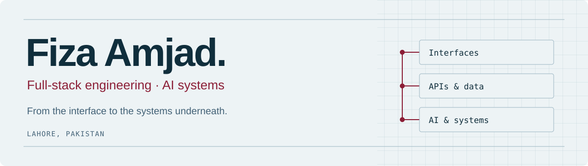

[**LinkedIn ↗**](https://www.linkedin.com/in/fiza-amjad/) · [**Email ↗**](mailto:fizaamjad444@gmail.com) · [**Explore my work ↓**](#selected-work)

I’m **Fiza**, a full-stack engineer in Lahore, Pakistan. I build product interfaces, the services behind them, and AI systems that can explain where an answer came from.

My work runs from **React and TypeScript to retrieval pipelines, distributed caches, and C/GTK**. I like owning the whole path: understand the problem, make the architectural calls, ship it, and work through what breaks.

### What I bring to a team

- **End-to-end product engineering.** Frontend, APIs, databases, authentication, integrations, and deployment.
- **AI with a traceable workflow.** Codebase retrieval, embeddings, reasoning traces, email classification, and model fallbacks.
- **Technical ownership.** At Techinoid, I worked across four client-facing products and led a team of six through planning, reviews, and delivery.

## Selected work

| Project | What I built | Main tools |
| :--- | :--- | :--- |
| **[Smart Inbox](https://github.com/fizaamjd/Smart-Inbox)** | Email classification and routing, with a multi-user dashboard, per-user rules, and keyword fallback. | React · Express · MongoDB · n8n · Groq |
| **[Versa](https://github.com/fizaamjd/Versa)** | A creative workflow spanning web, image processing, and mobile. **[Live app ↗](https://versa-workspace.vercel.app/)** | Next.js · FastAPI · Gemini |
| **[StaffFlow](https://github.com/fizaamjd/StaffFlow)** | Shift management with an explainable scheduling engine. | Next.js · Node.js · Express |
| **[Infinium](https://github.com/fizaamjd/Infinium)** | A repository-aware AI developer assistant with code ingestion, retrieval, reasoning, and VS Code integration. | Python · FastAPI · ChromaDB · Ollama |
| **[CacheNet](https://github.com/fizaamjd/CacheNet)** | A distributed cache simulator with network faults, chaos testing, and live telemetry. **[Live app ↗](https://cachenet-simulator.vercel.app/)** | Python · FastAPI · Next.js |
| **[ThePostal](https://github.com/fizaamjd/ThePostal)** | A mail server that follows SMTP over a socket, with protocol-level execution traces. | TypeScript · Fastify · Next.js |

**Closer to the hardware:** [CustomOS](https://github.com/fizaamjd/OSFinalProject), a C/GTK desktop simulator for Ubuntu, and [Chroma-Link-IoT](https://github.com/fizaamjd/Chroma-Link-IoT), an RGB controller connecting MQTT commands to an Arduino through an ESP32 bridge.

## Engineering toolkit

| Area | Tools I work with |
| :--- | :--- |
| **Interfaces** | TypeScript, JavaScript, React, Next.js, React Native, Tailwind CSS |
| **Services & data** | Node.js, NestJS, Express, Python, FastAPI, PostgreSQL, MongoDB, GraphQL |
| **AI systems** | RAG, LangChain, ChromaDB, Ollama, embeddings, TensorFlow, PyTorch |
| **Systems & delivery** | C, GTK, AVR assembly, Docker, WebSockets, Linux, Git |

## A little more about me

BSc Computer Science at **UET Lahore**, 2022–2026 · **3.68/4.00 CGPA**. Previously Software Engineer Intern at Tiers Limited. I also served as Creative Lead for Google Developer Groups on Campus at UET Lahore.

I’m most interested in work where the problem crosses layers: a useful interface, a reliable service, and clear decisions underneath both.

**Have something in mind?** [Let’s talk on LinkedIn](https://www.linkedin.com/in/fiza-amjad/) or [send me an email](mailto:fizaamjad444@gmail.com).
